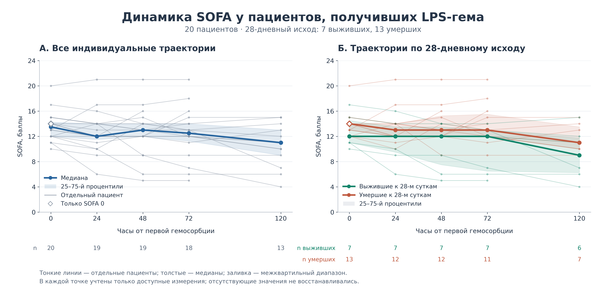

Данные и код для воспроизведения графиков динамики SOFA у пациентов, получивших лечение методом ЛПС-сорбции с применением картриджей LPS-ГЕМО

## Данные

Файл [`figures/sofa/data/sofa.csv`](figures/sofa/data/sofa.csv) содержит **обезличенные исходные данные пациентов с первого по двадцатый (P01–P20), использованные для построения графиков**: значения SOFA и 28-дневный исход. Одна строка — один пациент. Текущая выборка: 20 пациентов, 7 выживших к 28-м суткам и 13 умерших к этому сроку.

| Поле | Значение |
| --- | --- |
| `patient_id` | Условный код пациента P01–P20 |
| `survived_28d` | 1 — выжил к 28-м суткам; 0 — умер к этому сроку |
| `sofa_0` | SOFA перед первой гемосорбцией |
| `sofa_24`, `sofa_48`, `sofa_72`, `sofa_120` | SOFA через указанное число часов |

Фамилии, даты и номера историй болезни не включены. Исходные значения перенесены из предоставленной таблицы без пересчёта компонентов SOFA. Пустая ячейка означает отсутствие измерения, а не нулевой балл. Отдельные даты и причины окончания наблюдения в этом наборе отсутствуют.

## Построение графиков

- Панель А: индивидуальная линия каждого пациента, общая медиана и межквартильный диапазон.
- Панель Б: индивидуальные линии и отдельные медианы с межквартильными диапазонами по 28-дневному исходу.
- Ось времени имеет реальные интервалы: 0, 24, 48, 72 и 120 часов (5 суток) от первой гемосорбции. 
- Медиана и 25-й/75-й процентили рассчитываются отдельно в каждой точке по доступным значениям: `numpy.nanquantile(..., method="linear")`.
- Заливка показывает межквартильный диапазон, а не доверительный интервал. Под графиками указано число доступных измерений.


Состав пациентов с доступными измерениями меняется со временем. Поэтому изменение медиан не равно парному изменению у всей исходной выборки. Графики описательные: статистические тесты и оценка причинного эффекта гемосорбции не выполняются.

## Как посмотреть готовый график

В репозитории сохранены два файла одного графика:

- [SOFA_LPS_GEMA.png](figures/sofa/output/SOFA_LPS_GEMA.png) — копия для просмотра в браузере, просмотра изображений и вставки в презентацию (300 dpi).
- [SOFA_LPS_GEMA.svg](figures/sofa/output/SOFA_LPS_GEMA.svg) — векторный файл для редактирования и масштабирования без потери качества. 

Оба файла находятся в `figures/sofa/output/` и создаются одним запуском скрипта из тех же данных.

## Как запустить код 

Нужен Python 3.12; версии NumPy и Matplotlib закреплены в `requirements.txt`.

### Windows

1. Установите Python 3.12 с [python.org](https://www.python.org/downloads/). При установке включите Python Launcher и пункт **Add python.exe to PATH**.
2. На главной странице репозитория нажмите **Code → Download ZIP**. Распакуйте архив.
3. Откройте распакованную папку, в которой находятся `README.md` и `requirements.txt`. Нажмите адресную строку Проводника, введите `cmd` и нажмите Enter. Командная строка откроется в этой папке.
4. Выполните команды по очереди, дожидаясь завершения каждой:

```bat
py -3.12 -m venv .venv
.venv\Scripts\python.exe -m pip install -r requirements.txt
.venv\Scripts\python.exe figures\sofa\plot_sofa.py
```

Первая команда создаёт отдельное окружение Python, вторая устанавливает библиотеки, третья строит график.

5. Откройте папку `figures\sofa\output` и дважды нажмите `SOFA_LPS_GEMA.png`. Рядом будет файл `SOFA_LPS_GEMA.svg`.

Скрипт сохраняет файлы, но не открывает отдельное окно графика. При повторном запуске PNG и SVG перезаписываются. После изменения данных или оформления достаточно повторить третью команду. Если команда `py` не найдена, переустановите Python с включённым Python Launcher.

### macOS / Linux

Установите Python 3.12 и откройте терминал в распакованной папке репозитория:

```bash
python3.12 -m venv .venv
.venv/bin/python -m pip install -r requirements.txt
.venv/bin/python figures/sofa/plot_sofa.py
```

Откройте созданный файл `figures/sofa/output/SOFA_LPS_GEMA.png`.

### Что менять

- `figures/sofa/style.json` — цвета, размер, шрифт, толщина линий и прозрачность.
- `figures/sofa/plot_sofa.py` — подписи, легенды и расположение элементов.
- `figures/sofa/data/sofa.csv` — данные без фамилий; `survived_28d`: 1 — выжил, 0 — умер.

Скрипт также печатает число измерений и квартильные значения для проверки расчётов. SVG сохраняет текст редактируемым.


## Результат построения



