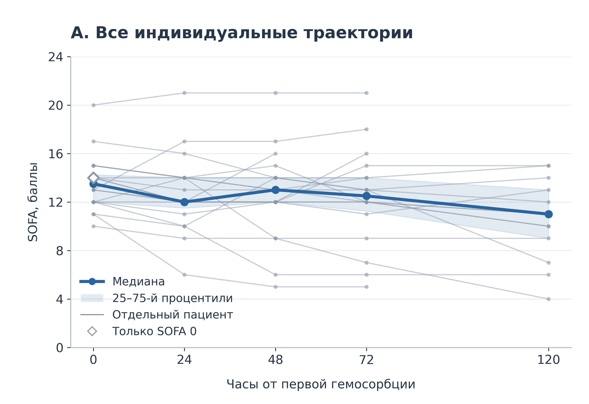
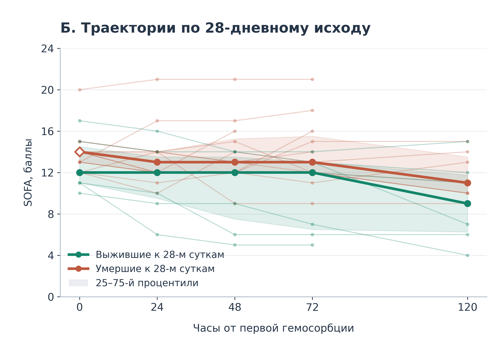
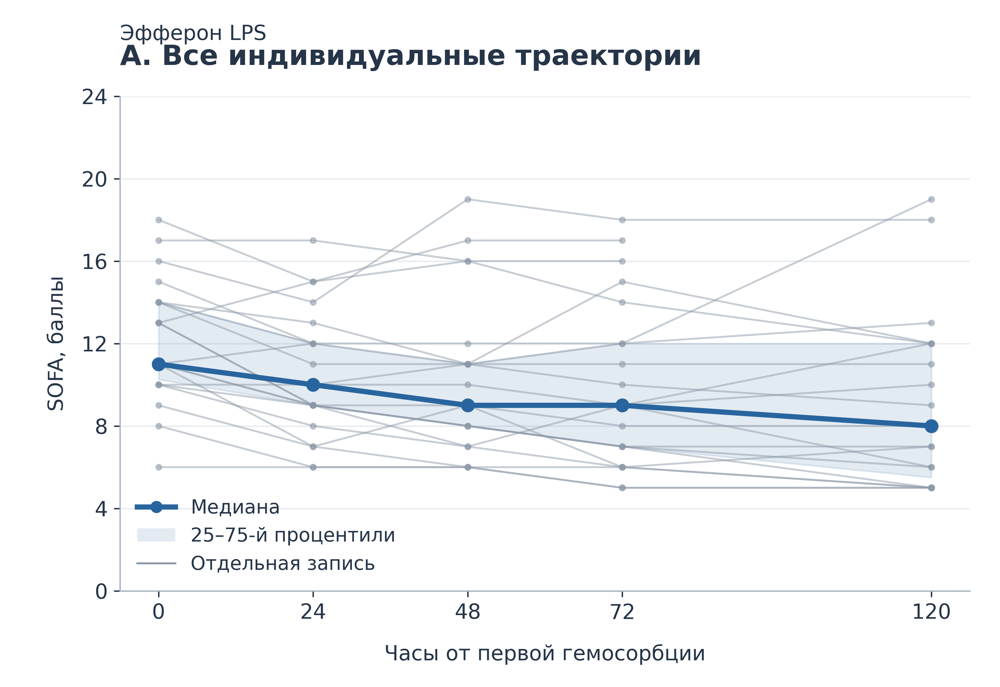
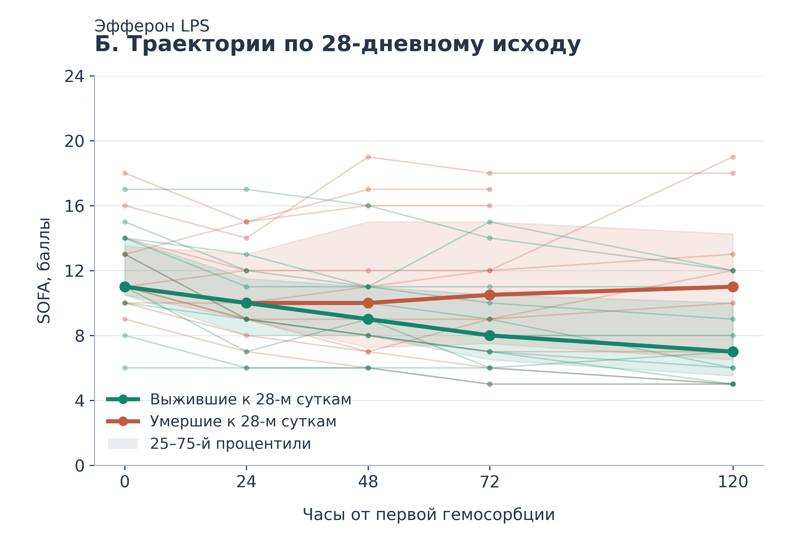

# Динамика SOFA после ЛПС-сорбции

Данные и код для воспроизведения графиков динамики SOFA при применении **LPS-Gema (ЛПС-ГЕМО)** и **Эфферон LPS**. Каждая когорта представлена отдельным набором данных и отдельными графиками. Сравнение эффективности картриджей между собой не выполняется.

## Когорты и файлы

| Когорта | Исходные данные | Код | Готовые графики |
| --- | --- | --- | --- |
| LPS-Gema: 20 пациентов P01–P20 | [CSV](figures/sofa/data/sofa.csv) | [plot_sofa.py](figures/sofa/plot_sofa.py) | [Папка output](figures/sofa/output/) |
| Эфферон LPS: 22 записи E01–E22 | [CSV](figures/sofa_efferon/data/sofa.csv) | [plot_sofa.py](figures/sofa_efferon/plot_sofa.py) | [Папка output](figures/sofa_efferon/output/) |

Для Эфферон LPS данные перенесены со второго листа «Эфферон-ЛПС» предоставленного файла `SOFA(1).xlsx`. Подробные результаты и примечания к данным приведены в [описании когорты](figures/sofa_efferon/README.md).

**Примечание к Эфферон LPS:** в исходном листе у строк 13 и 14 совпадает фамилия, при этом различаются значения SOFA и исходы. Они сохранены как E12 и E13. Без уточнения нельзя установить, относятся ли они к разным пациентам, разным эпизодам или ошибке ввода. Поэтому объём этого набора обозначен как **22 записи**, а число уникальных пациентов не утверждается.

## Данные

Оба CSV содержат обезличенные исходные значения SOFA и 28-дневный исход. Номера записей присвоены в порядке строк соответствующего листа. Коды разных когорт не связываются между собой.

| Поле | Значение |
| --- | --- |
| `patient_id` (LPS-Gema) | Условный код пациента P01–P20 |
| `record_id` (Эфферон LPS) | Условный код исходной записи E01–E22 |
| `survived_28d` | 1 — выжил к 28-м суткам; 0 — умер к этому сроку, по исходной таблице |
| `discharged` (Эфферон LPS) | 1 — в исходной таблице отмечена выписка; 0 — выписка не отмечена. Ноль сам по себе не подтверждает госпитальную смерть |
| `sofa_0` | SOFA перед первой гемосорбцией |
| `sofa_24`, `sofa_48`, `sofa_72`, `sofa_120` | SOFA через указанное число часов |

LPS-Gema: 20 пациентов, 7 выживших к 28-м суткам и 13 умерших к этому сроку. Эфферон LPS: в 11 из 22 записей указан `survived_28d=1`, в 11 — `survived_28d=0`; выписка отмечена в 6 записях.

Фамилии, инициалы, даты и номера историй болезни не включены. Исходная книга Excel в репозиторий не загружается. Значения перенесены без пересчёта компонентов SOFA. Пустая ячейка означает отсутствие измерения, а не нулевой балл. Даты и причины окончания наблюдения в этих CSV отсутствуют.

## Построение графиков

- График А: индивидуальные траектории, общая медиана и межквартильный диапазон.
- График Б: индивидуальные траектории и отдельные медианы с межквартильными диапазонами по 28-дневному исходу.
- Ось времени имеет реальные интервалы: 0, 24, 48, 72 и 120 часов (5 суток) от первой гемосорбции.
- Медиана и 25-й/75-й процентили рассчитываются отдельно в каждой точке по доступным значениям: `numpy.nanquantile(..., method="linear")`.
- Заливка показывает межквартильный диапазон, а не доверительный интервал.
- Пропуски не заполняются. Индивидуальные линии заканчиваются на последнем доступном измерении; при промежуточном пропуске линия разрывается.

Состав записей с доступными измерениями меняется со временем. Поэтому изменение медиан не равно парному изменению у всей исходной выборки. Графики описательные: статистические тесты и оценка причинного эффекта гемосорбции не выполняются.

Для Эфферон LPS дополнительно сохраняется [summary.csv](figures/sofa_efferon/output/summary.csv): число доступных измерений, медиана и квартили в каждой временной точке для всех записей и отдельно по 28-дневному исходу.

## Готовые графики

Для каждого графика доступны **PNG с прозрачным фоном, 450 dpi, 3600 × 2475 пикселей**, и **SVG с редактируемым текстом**.

| Когорта | График А: все траектории | График Б: по 28-дневному исходу |
| --- | --- | --- |
| LPS-Gema | [PNG](figures/sofa/output/SOFA_LPS_GEMA_A.png) · [SVG](figures/sofa/output/SOFA_LPS_GEMA_A.svg) | [PNG](figures/sofa/output/SOFA_LPS_GEMA_B.png) · [SVG](figures/sofa/output/SOFA_LPS_GEMA_B.svg) |
| Эфферон LPS | [PNG](figures/sofa_efferon/output/SOFA_EFFERON_LPS_A.png) · [SVG](figures/sofa_efferon/output/SOFA_EFFERON_LPS_A.svg) | [PNG](figures/sofa_efferon/output/SOFA_EFFERON_LPS_B.png) · [SVG](figures/sofa_efferon/output/SOFA_EFFERON_LPS_B.svg) |

Все графики LPS-Gema остаются в `figures/sofa/output/`, графики Эфферон LPS — в `figures/sofa_efferon/output/`. Каждый скрипт строит только свою когорту.

## Как запустить код

Нужен Python 3.12; версии NumPy и Matplotlib закреплены в `requirements.txt`. Excel, VPN и запросы к ChatGPT для построения графиков не требуются. После установки библиотек скрипты работают с локальными CSV.

### Windows

1. Установите Python 3.12 с [python.org](https://www.python.org/downloads/). При установке включите Python Launcher и пункт **Add python.exe to PATH**.
2. На главной странице репозитория нажмите **Code → Download ZIP**. Распакуйте архив.
3. Откройте распакованную папку, в которой находятся `README.md` и `requirements.txt`. Нажмите адресную строку Проводника, введите `cmd` и нажмите Enter.
4. Выполните команды по очереди, дожидаясь завершения каждой:

```bat
py -3.12 -m venv .venv
.venv\Scripts\python.exe -m pip install -r requirements.txt
.venv\Scripts\python.exe figures\sofa\plot_sofa.py
.venv\Scripts\python.exe figures\sofa_efferon\plot_sofa.py
```

Первые две команды создают отдельное окружение Python и устанавливают библиотеки. Третья строит графики LPS-Gema, четвёртая — Эфферон LPS. Если нужна одна когорта, выполните только соответствующую команду построения.

5. Откройте нужную папку `output` и выберите PNG или SVG.

Скрипты сохраняют файлы, но не открывают отдельное окно графика. При повторном запуске результаты соответствующей когорты перезаписываются. После изменения данных или оформления достаточно повторить её команду построения. Если команда `py` не найдена, переустановите Python с включённым Python Launcher.

### macOS / Linux

Установите Python 3.12 и откройте терминал в распакованной папке репозитория:

```bash
python3.12 -m venv .venv
.venv/bin/python -m pip install -r requirements.txt
.venv/bin/python figures/sofa/plot_sofa.py
.venv/bin/python figures/sofa_efferon/plot_sofa.py
```

### Что менять

В папке соответствующей когорты (`figures/sofa/` или `figures/sofa_efferon/`):

- `style.json` — цвета, размер, шрифт, толщина линий и прозрачность.
- `plot_sofa.py` — подписи, легенды и расположение элементов.
- `data/sofa.csv` — исходные данные без фамилий.

Скрипты также печатают число доступных измерений и квартили для проверки расчётов. У Эфферон LPS те же результаты записываются в `output/summary.csv`. В этом файле `all` означает все записи, `survivors` — записи с `survived_28d=1`, `deceased` — с `survived_28d=0`.

## Результат построения: LPS-Gema





## Результат построения: Эфферон LPS






