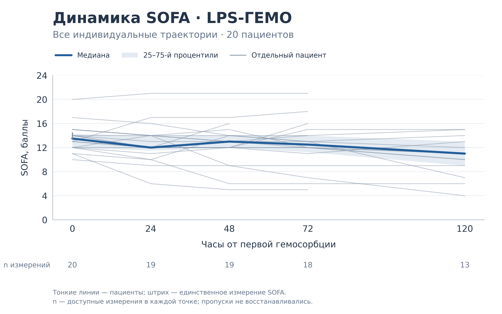
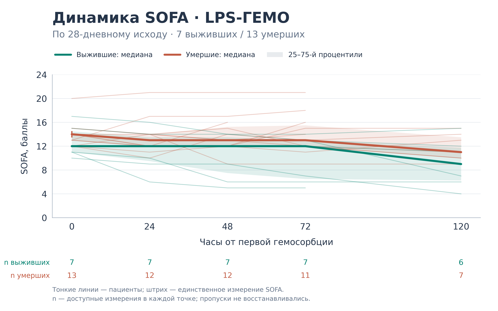

Данные и код для воспроизведения графиков динамики SOFA у пациентов, получивших лечение методом ЛПС-сорбции с применением картриджей LPS-ГЕМО

## Данные

Файл [`figures/sofa/data/sofa.csv`](figures/sofa/data/sofa.csv) содержит **обезличенные исходные данные пациентов с первого по двадцатый (P01–P20), использованные для построения графиков**: значения SOFA и 28-дневный исход. Одна строка — один пациент. Текущая выборка: 20 пациентов, 7 выживших к 28-м суткам и 13 умерших к этому сроку.

| Поле | Значение |
| --- | --- |
| `patient_id` | Условный код пациента P01–P20 |
| `survived_28d` | 1 — выжил к 28-м суткам; 0 — умер к этому сроку |
| `sofa_0` | SOFA перед первой гемосорбцией |
| `sofa_24`, `sofa_48`, `sofa_72`, `sofa_120` | SOFA через указанное число часов |

Фамилии, даты и номера историй болезни не включены. Исходные значения перенесены из предоставленной таблицы без пересчёта компонентов SOFA. Пустая ячейка означает отсутствие измерения, а не нулевой балл. Отдельные даты и причины окончания наблюдения в этом наборе отсутствуют.

## Построение графиков

- Панель А: индивидуальная линия каждого пациента, общая медиана и межквартильный диапазон.
- Панель Б: индивидуальные линии и отдельные медианы с межквартильными диапазонами по 28-дневному исходу.
- Ось времени имеет реальные интервалы: 0, 24, 48, 72 и 120 часов (5 суток) от первой гемосорбции. 
- Медиана и 25-й/75-й процентили рассчитываются отдельно в каждой точке по доступным значениям: `numpy.nanquantile(..., method="linear")`.
- Заливка показывает межквартильный диапазон, а не доверительный интервал. Под графиками указано число доступных измерений.


Состав пациентов с доступными измерениями меняется со временем. Поэтому изменение медиан не равно парному изменению у всей исходной выборки. Графики описательные: статистические тесты и оценка причинного эффекта гемосорбции не выполняются.

## Готовые графики: два отдельных рисунка

Графики разделены: каждый можно отдельно вставить, переместить и масштабировать на слайде. Для каждого рисунка скрипт автоматически создаёт три файла в `figures/sofa/output/`:

| Рисунок | Для PowerPoint: прозрачный PNG | Для статьи: белый PNG | Векторный SVG |
| --- | --- | --- | --- |
| Все пациенты | [SOFA_LPS_GEMA_all_presentation.png](figures/sofa/output/SOFA_LPS_GEMA_all_presentation.png) | [SOFA_LPS_GEMA_all_publication.png](figures/sofa/output/SOFA_LPS_GEMA_all_publication.png) | [SOFA_LPS_GEMA_all.svg](figures/sofa/output/SOFA_LPS_GEMA_all.svg) |
| По 28-дневному исходу | [SOFA_LPS_GEMA_outcomes_presentation.png](figures/sofa/output/SOFA_LPS_GEMA_outcomes_presentation.png) | [SOFA_LPS_GEMA_outcomes_publication.png](figures/sofa/output/SOFA_LPS_GEMA_outcomes_publication.png) | [SOFA_LPS_GEMA_outcomes.svg](figures/sofa/output/SOFA_LPS_GEMA_outcomes.svg) |

- Оба вида PNG экспортируются непосредственно из Python в **4800 × 3000 пикселей, 400 dpi** при размере фигуры 12 × 7,5 дюйма. Это новый рендер исходных данных, а не увеличение старого изображения.
- Файлы `*_presentation.png` имеют прозрачный фон фигуры и области построения. Текст и оси тёмные: оформление рассчитано на белые и светлые слайды.
- Файлы `*_publication.png` имеют белый непрозрачный фон.
- SVG также имеет прозрачный фон; надписи сохраняются текстом (`svg.fonttype="none"`), а не контурами букв. Круглые маркеры убраны; совместимость SVG с режимом показа конкретной версии PowerPoint нужно проверять отдельно.
- Индивидуальные линии стали спокойнее, медианы выделены более толстой линией, подписи увеличены, а легенды вынесены за пределы области данных. Прямые отрезки и реальные интервалы времени сохранены; сглаживание и восстановление пропусков не применяются.
- Единственное доступное значение обозначено коротким вертикальным штрихом: без него траектория с одним измерением стала бы невидимой.

Исходный двухпанельный [PNG](figures/sofa/output/SOFA_LPS_GEMA.png) и [SVG](figures/sofa/output/SOFA_LPS_GEMA.svg) сохранены как архивная версия. Новый скрипт их не перезаписывает.

### Вставка в PowerPoint

1. Откройте нужный `*_presentation.png` в GitHub и скачайте исходный файл кнопкой **Download raw file**. Не используйте снимок экрана или уменьшенное превью.
2. В PowerPoint выберите **Вставка → Рисунки → Это устройство** и вставьте скачанный PNG.
3. В PowerPoint для Windows: **Файл → Параметры → Дополнительно → Размер и качество изображения**. Выберите текущую презентацию, включите **Не сжимать изображения в файле** и установите **Высокое качество / High fidelity**, если этот пункт доступен. Названия зависят от версии Office.
4. Сохраните файл и проверьте слайд в режиме показа на компьютере для выступления.

## Как запустить код 

Нужен Python 3.12; версии NumPy и Matplotlib закреплены в `requirements.txt`.

### Windows

1. Установите Python 3.12 с [python.org](https://www.python.org/downloads/). При установке включите Python Launcher и пункт **Add python.exe to PATH**.
2. На главной странице репозитория нажмите **Code → Download ZIP**. Распакуйте архив.
3. Откройте распакованную папку, в которой находятся `README.md` и `requirements.txt`. Нажмите адресную строку Проводника, введите `cmd` и нажмите Enter. Командная строка откроется в этой папке.
4. Выполните команды по очереди, дожидаясь завершения каждой:

```bat
py -3.12 -m venv .venv
.venv\Scripts\python.exe -m pip install -r requirements.txt
.venv\Scripts\python.exe figures\sofa\plot_sofa.py
```

Первая команда создаёт отдельное окружение Python, вторая устанавливает библиотеки, третья строит два отдельных графика и сохраняет шесть файлов.

5. Откройте папку `figures\sofa\output`. Для презентации используйте `SOFA_LPS_GEMA_all_presentation.png` и `SOFA_LPS_GEMA_outcomes_presentation.png`; рядом находятся версии на белом фоне и SVG.

Скрипт сохраняет файлы, но не открывает отдельное окно графика. При повторном запуске шесть новых PNG/SVG перезаписываются; архивная двухпанельная версия сохраняется. После изменения данных или оформления достаточно повторить третью команду. Если команда `py` не найдена, переустановите Python с включённым Python Launcher.

### macOS / Linux

Установите Python 3.12 и откройте терминал в распакованной папке репозитория:

```bash
python3.12 -m venv .venv
.venv/bin/python -m pip install -r requirements.txt
.venv/bin/python figures/sofa/plot_sofa.py
```

Откройте созданные файлы `figures/sofa/output/SOFA_LPS_GEMA_all_presentation.png` и `figures/sofa/output/SOFA_LPS_GEMA_outcomes_presentation.png`.

### Что менять

- `figures/sofa/style.json` — цвета, размер, шрифт, толщина линий, прозрачность и `png_dpi`. Размер PNG равен размеру фигуры в дюймах × dpi; автоматическая обрезка выключена для точного размера холста.
- `figures/sofa/plot_sofa.py` — подписи, легенды и расположение элементов.
- `figures/sofa/data/sofa.csv` — данные без фамилий; `survived_28d`: 1 — выжил, 0 — умер.

Скрипт также печатает число измерений и квартильные значения для проверки расчётов. SVG сохраняет текст редактируемым.


## Результаты построения

Ниже — версии на белом фоне для просмотра. Прозрачные PNG для PowerPoint доступны в таблице выше.

### Все пациенты



### По 28-дневному исходу


